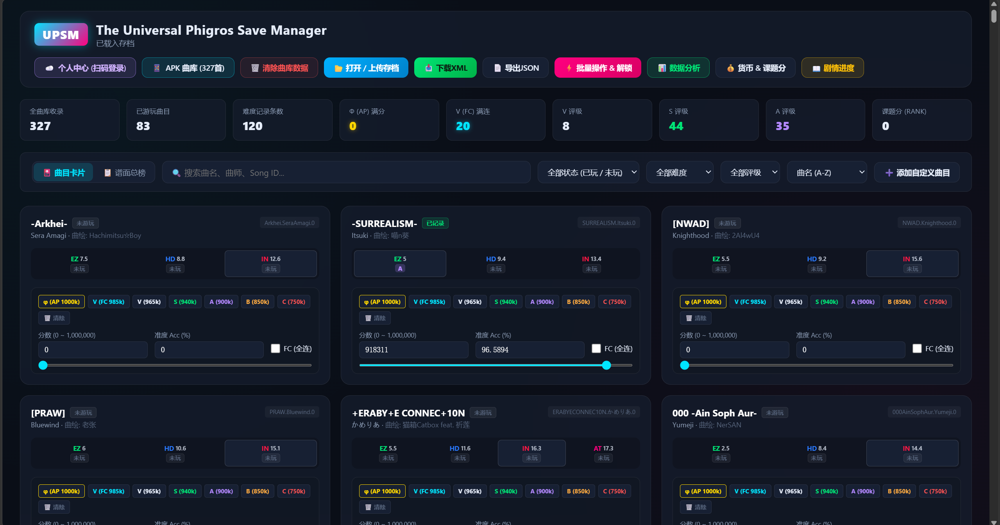
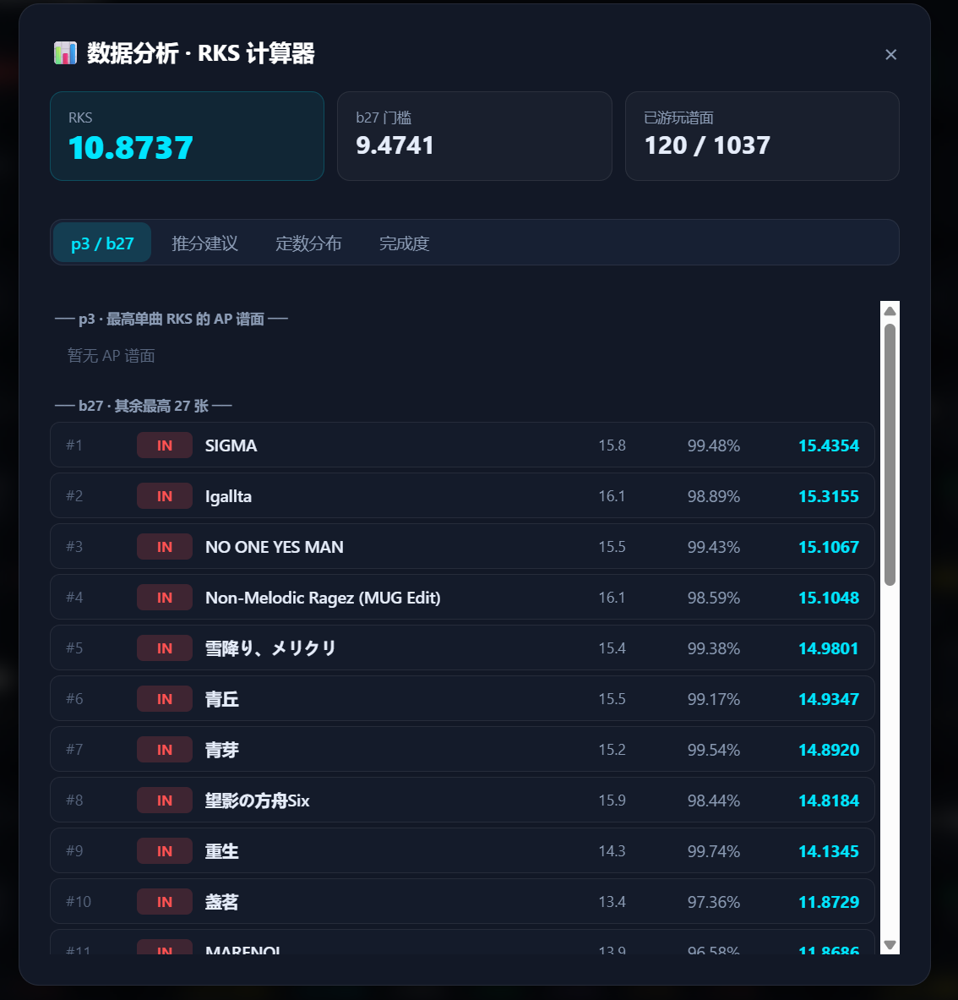
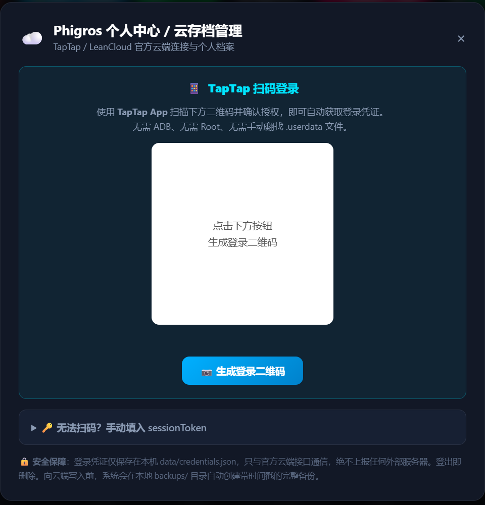

<div align="center">

# UPSM

### The Universal Phigros Save Manager

**或许是最好的 Phigros 存档工具**

[](https://www.python.org/)
[](https://www.starlette.io/)
[](web/index.html)
[](LICENSE)
[](#-启动方式)

[](#-离线优先)
[](#-关于游戏数据)
[](#)
[](#-数据分析--rks-计算器)

本地 WebUI 存档管理器 · 本地与云端双向同步 · 离线 RKS 数据分析



</div>

---

## ⚠️ 免责声明

**请在使用本工具前完整阅读本节。**

### 致游戏厂商与云服务提供方

本项目是一个**个人存档备份与管理工具**。其云端相关功能的唯一目的，是让玩家能够**备份、导出和恢复属于自己账号的存档数据**，这与各主流平台普遍承认的"用户有权导出自己的数据"原则一致。

- 本工具**仅访问使用者本人登录的账号**，不具备、也不尝试访问任何第三方账号的能力。
- 本工具**不含任何破解、绕过付费、伪造凭证或攻击服务端的行为**，登录流程使用官方 TapTap OAuth 设备码授权。
- 本工具**不内置、不分发任何游戏专有资产**（详见[关于游戏数据](#-关于游戏数据)）。
- 本工具与 Pigeon Games、TapTap 及其关联方**无任何隶属、授权或合作关系**。Phigros 是其各自权利人的商标。

若权利人认为本项目的任何部分存在不当之处，请通过 Issue 联系，我们会认真对待并及时处理。

### 致音游圈

**本工具无意扰乱任何社区秩序。** 它是一个存档管理与数据分析工具，不是炫耀的手段。

- 任何通过修改存档得到的成绩，**都不代表真实游玩水平**，请勿用于向他人展示、排名比较或任何形式的竞技场合。
- 请**不要**将修改后的数据用于查分器、社群排行、比赛报名或主播展示。这会伤害真正认真练习的玩家。
- 本项目的 RKS 分析功能，设计初衷是帮助玩家**理解自己的成绩分布、规划练习方向**——推分建议告诉你"该练哪首"，而不是"该改哪首"。
- 修改存档可能违反游戏用户协议，**一切后果由使用者自行承担**。作者不对封号、数据丢失或任何其他损失负责。

### 关于数据安全

- 所有解析、加解密、分析均在**你自己的机器上离线完成**，不上传任何数据到第三方服务器。
- 云端上传/下载**仅与官方服务端直接通信**。
- 每次云端读写前，都会在 `backups/` 自动生成带时间戳的完整原始备份。
- 登录凭证保存在本地 `data/credentials.json`（已被 `.gitignore` 忽略）。**该文件等同于你的账号权限，请勿分享或提交到仓库。**

---

## ✨ 核心特性

### 🔐 通用存档格式支持

一套编辑器，三种格式，自动识别：

| 格式 | 来源 | 识别方式 |
|---|---|---|
| 加密 XML | 本地 PlayerPrefs (`com.PigeonGames.Phigros.v2.playerprefs.xml`) | 默认 |
| 明文 JSON | 本工具导出的解密备份 | 首字节 `{` |
| 云存档 `.save` | TapTap 云端 / 手动下载 | ZIP 魔数 `PK` |

- **AES-256-CBC** 解密（PKCS7 填充，Base64 + URL `%2F` 转义），本地与云端两套独立密钥。
- **导出通用**：无论当前编辑的是哪种格式，都能导出为加密 XML 或明文 JSON。
- **前向兼容**：云存档的 5 个分区（`gameKey` / `gameProgress` / `gameRecord` / `settings` / `user`）独立解析，任一分区因游戏更新而无法识别时，**原始加密字节会被逐字节保留**，重新打包后不会损坏该分区。

### 📊 数据分析 · RKS 计算器

<div align="center">

</div>

**完全离线**——不需要登录，不需要联网，任何格式的存档都能分析。

- **p3 / b27 明细**：两个池子不重叠（入选 p3 的谱面会从 b27 候选中移除），除数固定为 30，与游戏内算法一致。b27 门槛行高亮标出。
- **推分建议**：两个维度自由组合
  - 排序：⚡ **最省力**（所需 ACC 增量最小）/ 💎 **最提分**（RKS 提升最大）
  - 范围：全部 / 仅已入 b30（打磨现有成绩）/ 仅榜外（冲榜候选）
- **定数分布**：按定数分段统计已游玩谱面数量与平均 ACC。
- **完成度**：各难度已游玩 / 总谱面数。

> 单曲 RKS 公式：`((ACC - 55) / 45)² × 定数`，ACC 低于 70% 计 0。

### 🎵 成绩编辑与全曲库

- 解析全部难度（`EZ` / `HD` / `IN` / `AT` / `Legacy`），支持 φ(AP) / V(FC) / V / S / A / B / C / False 预设一键设置与精确微调。
- **两种浏览视图**：
  - 🎴 **曲目卡片**——一卡一曲，内含各难度，适合编辑
  - 📋 **谱面总榜**——一行一谱，按单曲 RKS 全局排名，点击跳回卡片编辑
- 实时搜索 + 难度 / 评级 / 游玩状态筛选 + 多维排序（含**单曲 RKS 升降序**）。
- **批量操作**：全曲指定难度 AP / FC、100% 全解锁（单曲 `0key`、收藏品 `1key`、曲绘 `2key`、头像 `3key`、难度挑战 `Grade`）、Data 货币与课题分调整。

### ☁️ 云存档双向同步

<div align="center">

</div>

- **扫码登录**：使用官方 TapTap 设备码 OAuth 流程，手机 App 扫码确认即可，无需 ADB、无需 Root、无需手动翻找 `.userdata`。
- **凭证持久化**：登录后 `sessionToken` 保存在本地，下次启动自动重连。
- **像编辑本地存档一样编辑云存档**：从云端载入 → 在主界面随意修改 → 一键打包上传，Summary 摘要自动计算。
- **个人中心**：头像、昵称、RKS、课题模式评价、各难度通关统计；支持编辑个性签名、头像 ID、背景 ID 与游戏设置。
- **剧情进度编辑器**：仅在编辑云存档且 `gameProgress` 结构可识别时显示；若游戏更新导致结构无法解析，会明确告知并隐藏编辑器，而不是写入错误数据。
- **原始 `.save` 下载**：在个人中心可直接下载官方格式的加密存档备份。

---

## 🔒 离线优先

| 功能 | 需要联网 | 需要登录 |
|---|:---:|:---:|
| 载入 / 编辑 / 导出存档 | ❌ | ❌ |
| APK 曲库提取 | ❌ | ❌ |
| **RKS 数据分析** | ❌ | ❌ |
| 批量操作与全解锁 | ❌ | ❌ |
| 云端载入 / 上传 | ✅ | ✅ |

---

## 📦 关于游戏数据

**本项目不内置任何游戏专有资产与数据库文件**——没有曲目元数据、没有谱面定数表、没有插画或头像资源。这是为了尊重原开发商的著作权。

曲库数据需要你**从自己持有的游戏安装包中提取**：首次启动时按向导拖入官方 `.apk`，工具会使用 `UnityPy` 在本地离线解包，生成仅存在于你机器上的 `data/phigros_data.json`（已被 `.gitignore` 忽略，不随仓库分发）。

没有导入 APK 时，依赖定数的功能（RKS 分析、未游玩曲目编辑）会**引导你导入**，而不是显示一屏零值。

---

## 🚀 启动方式

### 环境要求

```bash
pip install -r requirements.txt
```

> `UnityPy` 为延迟导入的可选依赖——不装也能正常编辑存档，只是无法导入 APK 曲库。

### 方式一：双击启动（推荐 Windows）

```bat
run_webui.bat
```

自动检测端口、启动服务并打开浏览器：`http://127.0.0.1:8000`

### 方式二：命令行

```bash
python run_webui.py
```

---

## 📁 目录结构

```
├── core/
│   ├── crypto.py             # AES-256-CBC 加解密底层实现
│   ├── song_helper.py        # 评级计算、曲目解析与预设定义
│   ├── save_parser.py        # 本地 XML/JSON 解析、RKS 计算与数据分析
│   ├── apk_parser.py         # Phigros APK (UnityPy) 资源提取
│   ├── phi_struct.py         # 云存档二进制结构定义与版本化解析
│   ├── cloud_save_parser.py  # 云存档解密、解析、改写与重打包
│   ├── cloud_service.py      # LeanCloud API 客户端与七牛云上传
│   ├── taptap_login.py       # TapTap 设备码 OAuth 扫码登录
│   └── credentials.py        # 本地凭证存储
├── data/
│   ├── phigros_data.json     # 本地提取的曲库缓存（自动忽略）
│   ├── credentials.json      # 登录凭证（自动忽略，请勿分享）
│   └── typetree.json         # Unity MonoBehaviour 反序列化类型树
├── backups/                  # 云端读写前自动生成的带时间戳备份
├── web/
│   └── index.html            # 深色风格 WebUI 单页应用
├── server.py                 # Starlette + Uvicorn 异步后端
├── run_webui.py              # 跨平台启动脚本
└── run_webui.bat             # Windows 双击启动
```

---

## 📜 许可证

本项目采用 **[GNU General Public License v3.0](LICENSE)**。

这意味着你可以自由使用、修改和分发本项目，但基于本项目的衍生作品**必须同样以 GPL-3.0 开源**。本项目不提供任何担保。

```
UPSM - The Universal Phigros Save Manager
Copyright (C) 2026

This program is free software: you can redistribute it and/or modify
it under the terms of the GNU General Public License as published by
the Free Software Foundation, either version 3 of the License, or
(at your option) any later version.

This program is distributed in the hope that it will be useful,
but WITHOUT ANY WARRANTY; without even the implied warranty of
MERCHANTABILITY or FITNESS FOR A PARTICULAR PURPOSE.  See the
GNU General Public License for more details.
```

---

## 🙏 致谢

感谢以下开源项目与贡献者的技术启发：

- **[wms26/Phi-GetSession-python](https://github.com/wms26/Phi-GetSession-python)** —— 本项目的 TapTap 扫码登录流程参考了该项目对设备码 OAuth 的实现思路
- [wms26/Phi-CloudAction-python](https://github.com/wms26/Phi-CloudAction-python) —— 云存档结构与 RKS 算法参考
- [wms26/Phi-LocalAction-python](https://github.com/wms26/Phi-LocalAction-python)
- [7aGiven/Phigros_Resource](https://github.com/7aGiven/Phigros_Resource)
- [Bad0RANG3/Phigrsaves](https://github.com/Bad0RANG3/Phigrsaves)

---

<div align="center">

**请合理使用，尊重游戏、尊重开发者、尊重其他玩家。**

</div>
